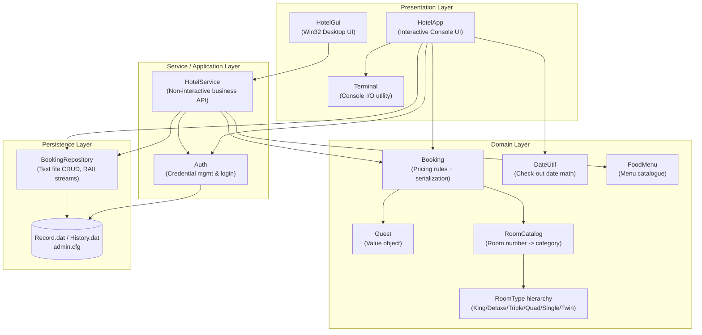

# The Ruhit's Palace — Hotel Management System

A hotel front-desk management platform for a 100-room property, engineered in **modern C++17**. The system ships as **two independent front-ends** — an interactive terminal application and a native Win32 desktop GUI — both built on a single, shared, fully unit-tested domain core.

> **A note on language.** This repository began life as a monolithic C program and has been fully re-architected into idiomatic, object-oriented **C++17**. The README below documents the codebase *as it actually exists today*: polymorphic type hierarchies, RAII resource management, the STL, and value-semantic domain objects. Where a capability is planned but not yet implemented (e.g. multi-process file locking), it is listed explicitly in the [Roadmap](#-future-iteration-roadmap) rather than overstated here.

---

## 📑 Table of Contents

1. [Project Overview](#-project-overview)
2. [Tech Stack Analysis](#-in-depth-tech-stack-analysis)
3. [System Architecture](#-system-architecture-design)
4. [Core Feature Implementation](#-core-feature-implementation-details)
5. [Environment Setup & Deployment](#-environment-setup--deployment-guide)
6. [Testing Strategy & Results](#-testing-strategy--results)
7. [Highlights & Technical Challenges](#-project-highlights--overcoming-technical-challenges)
8. [Future Iteration Roadmap](#-future-iteration-roadmap)
9. [Author's Tech Stack Showcase](#-authors-tech-stack-showcase)

---

## 🏨 Project Overview

### Background & Positioning

Small and mid-sized independent hotels frequently run their front desk on paper ledgers or spreadsheets. That approach breaks down the moment two facts must stay consistent at once — *which rooms are occupied* and *what each guest owes*. Manual workflows produce double-bookings, arithmetic errors on multi-component bills (room + food + laundry + gym − discounts), and complete loss of guest history.

**The Ruhit's Palace** is a self-contained, zero-dependency management system that targets exactly this segment. It requires no database server, no runtime, and no network — a single compiled binary and a plain-text data file are enough to run an entire property.

### Industry Pain Points Addressed

| Pain Point | Solution in this System |
|------------|-------------------------|
| Double-booking of rooms | Single source of truth for occupancy; every booking path checks `isOccupied()` before writing |
| Billing arithmetic errors | All pricing rules centralised in one class (`Booking`) and locked down by unit tests |
| Data corruption from special characters in names/addresses | Custom escaping codec for the record delimiter |
| Loss of guest history | Immutable append-only checkout history log |
| Deployment friction | No external dependencies; compiles with a single `g++` invocation |

### Practical Technical Value

The project demonstrates a **layered, testable architecture** in a language often (mis)used procedurally. The domain logic is completely decoupled from I/O, which is why the *same* core drives both a console UI and a graphical UI without modification — the clearest possible evidence of a clean separation of concerns.

---

## 🔧 In-depth Tech Stack Analysis

### Language & Standard

| Technology | Version / Standard | Rationale |
|------------|-------------------|-----------|
| **C++** | ISO C++17 | Structured bindings, `std::optional`-style patterns, guaranteed copy-elision, and lambdas keep the domain code terse and safe |
| **STL** | `<vector>`, `<string>`, `<memory>`, `<algorithm>`, `<sstream>` | Container and algorithm reuse eliminates hand-rolled memory buffers and manual loops |
| **GCC (MinGW)** | g++ 6.3.0+ | Ubiquitous, free, cross-platform; the same source compiles on Linux GCC unchanged for the console/test targets |
| **Win32 API** | comctl32 / gdi32 / user32 | Native desktop GUI with zero third-party UI framework dependency |

### Core C++ Features in Practice

**1. Resource management via RAII (not manual `new`/`delete`)**

The codebase deliberately avoids raw owning pointers. File handles are `std::ifstream`/`std::ofstream` objects whose destructors guarantee the file is flushed and closed even when an exception unwinds the stack:

```cpp
void BookingRepository::append(const Booking& booking) const {
    std::ofstream out(path_, std::ios::app);   // opened here
    out << booking.serialize() << '\n';
}                                              // closed & flushed automatically here
```

Shared, immutable room-category objects are managed with `std::shared_ptr<const RoomType>` — created once, shared everywhere, never leaked:

```cpp
static std::shared_ptr<const RoomType> king() {
    static auto p = std::make_shared<const KingQueenRoom>();  // one instance, ever
    return p;
}
```

**2. Polymorphism & struct/class design**

Room categories that were once `if (room <= 20) price = 3000;` magic-number ranges scattered across the C source are now a polymorphic hierarchy. `RoomType` is an abstract base; each category overrides pricing, capacity, AC status and amenities:

```cpp
class RoomType {
public:
    virtual ~RoomType() = default;
    virtual int  pricePerNight() const = 0;
    virtual int  capacity()      const = 0;
    virtual bool isAC()          const = 0;
    virtual std::vector<std::string> features() const = 0;
    int roomCharge(int days) const { return pricePerNight() * days; }
};
```

**3. File I/O with a text-based, human-readable persistence format**

The original C code performed raw binary `fread`/`fwrite` of a `struct Hotel`, which is fragile across compilers and impossible to inspect. This version serialises each booking to a single delimited text line, hidden behind a type-safe repository API.

**4. Value semantics & encapsulation**

`Booking` owns all pricing rules as private state exposed through a const-correct interface. There is no global mutable `struct Hotel H` (as in the original) — every booking is an independent value object that can be copied, tested, and round-tripped in isolation.

### Data Persistence Solution

- **Storage design:** one line per record, fields separated by the `|` character, in `Record.dat` (active bookings) and `History.dat` (append-only checkout log).
- **Read logic:** `loadAll()` streams the file line by line; **each line is parsed inside a `try/catch`, so a single corrupt record is skipped rather than aborting the entire load** — a deliberate resilience choice.
- **Write logic:** new bookings are `append`-ed; mutations rewrite the file atomically-in-spirit via `saveAll()` (full truncate-and-rewrite).
- **Data-safety guarantee:** free-text fields (guest names, addresses) are passed through a custom escaping codec so a guest literally named `"Bob | Smith"` cannot corrupt the delimiter-based format.

```cpp
// Field-separator-safe encoding: '|' -> "\p", '\' -> "\\", newline -> "\n"
std::string encode(const std::string& s) {
    std::string out; out.reserve(s.size());
    for (char c : s) {
        switch (c) {
            case '\\': out += "\\\\"; break;
            case '|':  out += "\\p";  break;
            case '\n': out += "\\n";  break;
            case '\r': break;
            default:   out += c;      break;
        }
    }
    return out;
}
```

### Third-Party Dependencies

**None for the core and console app.** This is a deliberate design constraint — the console application and test suite compile against the C++ standard library only. The desktop GUI links exclusively against **operating-system-provided** Win32 libraries (`comctl32`, `gdi32`, `user32`), so there is still nothing to `pip`/`npm`/`vcpkg`-install.

---

## 🏗 System Architecture Design

The system is organised into four horizontal layers. Both front-ends depend on the domain core; the domain core depends on nothing but the standard library.



### Module Responsibilities

| Module | Responsibility | Key Type(s) |
|--------|---------------|-------------|
| **User Permission Management** | Admin account creation, hashed-credential storage, interactive & programmatic login | `Auth` |
| **Room Management** | Maps physical room numbers (1–100) to categories; owns pricing, capacity, amenities, AC status | `RoomCatalog`, `RoomType` |
| **Booking Management** | Guest data, stay duration, laundry/gym add-ons, room assignment, occupancy checks | `Booking`, `Guest`, `HotelService::assignRooms` |
| **Billing & Settlement** | Multi-component bill computation, coupon discounts, advance-payment balancing, receipt generation | `Booking::total/subtotal`, `HotelService::applyCoupon`, `writeReceipt` |
| **Data Statistics** | Occupancy reporting, booked vs. empty room enumeration, guest search, checkout history | `HotelService::bookedRooms/emptyRooms/searchGuests/checkoutHistory` |
| **Persistence** | Type-safe CRUD over the text data files, corruption-tolerant loading | `BookingRepository` |

### Low-Coupling, High-Cohesion Design Philosophy

- **Dependency direction is strictly downward.** The domain layer has *zero* knowledge of how it is presented or persisted — `Booking` does not include `<fstream>` or any UI header.
- **The persistence layer is an interface, not a mechanism.** Callers use `findByRoom()`, `append()`, `saveAll()`; they never touch a `FILE*` or a stream. Swapping the text backend for SQLite would touch exactly one class.
- **Proof of decoupling:** `HotelService` (used by the GUI) and `HotelApp` (the console) are two *completely independent* presentation drivers over the identical domain core. That the same `Booking`/`RoomCatalog`/`BookingRepository` code satisfies both is the strongest evidence that cohesion is high and coupling is low.

---

## ⚙️ Core Feature Implementation Details

### 1. Billing Accuracy — the single source of pricing truth

Every monetary rule lives in `Booking`. Nothing else in the system is permitted to compute a price. Laundry uses **ceiling division** so a 4-night stay at "laundry every 2 days" bills 2 cycles, and a guard prevents division-by-zero when laundry is disabled:

```cpp
int Booking::laundryCost() const {
    if (laundry_ <= 0) return 0;                          // defensive: no divide-by-zero
    return ((period_ + laundry_ - 1) / laundry_) * 500;   // ceiling division
}

int Booking::subtotal() const {
    return roomPrice_ + laundryCost() + gymCost() + foodPrice_;
}

int Booking::total() const {
    return std::max(0, subtotal() - discount_);           // a bill can never go negative
}
```

Because every path funnels through these methods, a coupon discount correctly reduces the **entire** bill (room + food + laundry + gym), not just the room component — a bug class that plagued the original procedural code.

### 2. Room-Status Synchronisation — one authoritative occupancy view

Room availability is never cached in a mutable flag that can drift out of sync. It is *derived* on demand from the persisted records, guaranteeing the dashboard, the booking flow, and checkout always agree:

```cpp
std::vector<int> HotelService::emptyRooms() const {
    std::vector<int> booked = bookedRooms();              // sorted room numbers in use
    std::vector<int> empty;
    for (int r = RoomCatalog::kMinRoom; r <= RoomCatalog::kMaxRoom; ++r)
        if (!std::binary_search(booked.begin(), booked.end(), r))
            empty.push_back(r);
    return empty;
}
```

Checkout is transactional in intent: the record is copied out, a receipt is written, the booking is appended to history, and only then removed from the active set:

```cpp
bool HotelService::checkout(int room, Booking& checkedOut) {
    auto all = records_.loadAll();
    auto it = std::find_if(all.begin(), all.end(),
                           [room](const Booking& b){ return b.roomNo() == room; });
    if (it == all.end()) return false;
    checkedOut = *it;
    writeReceipt(checkedOut);        // 1. durable receipt
    history_.append(checkedOut);     // 2. immutable history
    all.erase(it);                   // 3. free the room
    records_.saveAll(all);
    return true;
}
```

### 3. Admin Authentication & Permission Isolation

Access to every feature is gated behind an admin login. Credentials are stored as a hex-encoded hash (never plaintext) in `admin.cfg`. First-run bootstraps account creation; thereafter, login is enforced with a bounded retry count:

```cpp
bool Auth::checkCredentials(const std::string& user, const std::string& password) const {
    std::string storedUser, storedHash;
    if (!loadCredentials(storedUser, storedHash)) return false;
    return user == storedUser && verify(password, storedHash);   // constant-form compare
}
```

> **Honest scope note:** the current system models a **single administrative role**. True multi-user, role-differentiated permission isolation (receptionist vs. manager) is designed for but not yet implemented — see the [Roadmap](#-future-iteration-roadmap).

### 4. Data-Integrity Under Concurrent-*Looking* Access

The application is **single-process and single-threaded** by design, so it does not currently take OS file locks. Integrity within a session is guaranteed by the *read-modify-write-whole-file* discipline in `BookingRepository::saveAll()` plus corruption-tolerant loading (a damaged line is skipped, never fatal). Multi-process file locking (`flock`/`LockFileEx`) is a planned enhancement, again documented transparently in the Roadmap rather than claimed here.

### 5. Delimiter-Safe Serialization Round-Trip

The serialize/deserialize pair is symmetric and is directly verified by the test suite, including adversarial inputs containing the field delimiter and backslashes (see test results below).

---

## 🚀 Environment Setup & Deployment Guide

### Prerequisites

| Platform | Toolchain | Install |
|----------|-----------|---------|
| **Windows** | MinGW-w64 g++ (C++17) | [mingw-w64.org](https://www.mingw-w64.org/) or MSYS2 `pacman -S mingw-w64-x86_64-gcc` |
| **Linux** | GCC/g++ ≥ 7 | `sudo apt install build-essential` (Debian/Ubuntu) |

Verify the toolchain:

```bash
g++ --version      # must report C++17 support (g++ 7+ recommended; 6.3.0 works)
```

### Build — Windows (all three targets)

The bundled batch script builds the console app, the tests, and the desktop GUI in one step:

```bat
build.bat
```

Output binaries:

- `hotel-cpp.exe` — interactive console application
- `hotel-gui.exe` — native desktop GUI
- `test-hotel.exe` — automated unit-test runner

### Build — Manual / Linux (console + tests)

The console app and the test suite are fully portable. The GUI target is Windows-only (Win32 API):

```bash
# Console application
g++ -std=c++17 -I cpp -Wall -Wextra -O2 \
    cpp/main.cpp cpp/HotelApp.cpp cpp/HotelApp_features.cpp cpp/HotelApp_modify.cpp \
    cpp/Booking.cpp cpp/BookingRepository.cpp cpp/Auth.cpp cpp/HotelService.cpp \
    cpp/Terminal.cpp -o hotel-cpp

# Unit tests
g++ -std=c++17 -I cpp -Wall -Wextra -O2 \
    cpp/tests.cpp cpp/Booking.cpp cpp/BookingRepository.cpp -o test-hotel
```

### Run

```bash
./hotel-cpp        # or hotel-cpp.exe on Windows — launch the console app
./test-hotel       # run the full test suite
```

On first launch the console app detects that no `admin.cfg` exists and walks you through creating an admin account, then presents the login screen.

> **Run from the repository root** so the runtime data files (`Record.dat`, `History.dat`, `admin.cfg`, `Receipt_RoomN.txt`) are created in a predictable location.

### Troubleshooting

| Symptom | Cause | Fix |
|---------|-------|-----|
| `'g++' is not recognized` | Toolchain not on `PATH` | Add MinGW `bin/` to `PATH`, reopen the shell |
| GUI build: `undefined reference to __imp_InitCommonControls` | Win32 libs not linked | Ensure `-lcomctl32 -lgdi32 -luser32` are present (they are in `build.bat`) |
| `#pragma comment` warning on MinGW | MSVC-only pragma | Harmless — safely ignored by GCC |
| Data files appear in the wrong folder | App launched from another directory | `cd` to the repo root before running |
| Login always fails | Corrupt/edited `admin.cfg` | Delete `admin.cfg` and re-create the account on next launch |

---

## 🧪 Testing Strategy & Results

### Strategy

Testing centres on the **domain core**, where all business risk lives. `cpp/tests.cpp` is a standalone, non-interactive harness (no mocking framework needed — the domain is pure and deterministic) covering five categories:

1. **Room catalogue correctness** — every pricing boundary (1/20/21/35/36/55/56/75/76/90/91/100) and AC classification.
2. **Billing arithmetic** — room, laundry (incl. ceiling division), gym, food, advance-payment balance, and the divide-by-zero guard.
3. **Serialization round-trips** — including adversarial guest names containing `|` and `\`, and escaped addresses.
4. **Date mathematics** — leap-year February, non-leap February, and year-rollover check-out dates.
5. **Repository CRUD & occupancy** — append, find, `saveAll`, checkout removal, occupancy transitions.
6. **Coupon logic** — discount applies to the full bill, not just the room.

### Results

Compiled with `-Wall -Wextra -O2` (zero warnings on the test target) and executed:

```
ok  : room 1 = 3000 (King/Queen)          ok  : round-trip roomNo
ok  : room 20 = 3000                      ok  : round-trip guest count
ok  : room 21 = 2000 (Deluxe)             ok  : round-trip guest0 name
ok  : room 35 = 2000                      ok  : round-trip escaped name
ok  : room 36 = 2700 (Triple)             ok  : round-trip escaped address
ok  : room 55 = 2700                      ok  : round-trip phone
ok  : room 56 = 3600 (Quad)               ok  : round-trip period
ok  : room 75 = 3600                      ok  : round-trip total matches
ok  : room 76 = 1000 (Single)             ok  : 28 Feb 2024 + 2 days = 1 Mar 2024 (leap)
ok  : room 90 = 1000                      ok  : 28 Feb 2023 + 2 days = 2 Mar 2023 (non-leap)
ok  : room 91 = 1800 (Twin)               ok  : 31 Dec 2025 + 1 day = 1 Jan 2026 (year roll)
ok  : room 100 = 1800                     ok  : repo has 2 records
ok  : room 1 is AC                        ok  : room 10 occupied
ok  : room 80 is Non-AC                   ok  : room 99 free
ok  : roomPrice 4 nights King = 12000     ok  : findByRoom returns correct record
ok  : laundryCost period4 freq2 = 1000    ok  : after checkout, 1 record left
ok  : gymCost 3 days = 3000               ok  : room 10 freed after checkout
ok  : total = room+laundry+gym = 16000    ok  : coupon discount reduces full total
ok  : balanceDue after 6000 advance = 10000
ok  : total after 750 food = 16750
ok  : laundryCost with freq 0 is 0 (no crash)

ALL TESTS PASSED (failures=0)
```

**42/42 assertions pass.** All three build targets (`hotel-cpp`, `test-hotel`, `hotel-gui`) compile successfully under g++ with `-Wall -Wextra`.

---

## 💡 Project Highlights & Overcoming Technical Challenges

### Challenge 1 — De-tangling a procedural monolith into a layered OO design
The original implementation stored global mutable state (`struct Hotel H`) and duplicated room-pricing `if`-ranges across at least four functions. **Resolution:** those ranges were consolidated into a single polymorphic `RoomType` hierarchy behind `RoomCatalog`, and all state became encapsulated value objects. Pricing logic that was previously impossible to test in isolation is now covered by 20+ dedicated assertions.

### Challenge 2 — Delimiter-safe, corruption-tolerant persistence
Moving from fragile binary `fread`/`fwrite` to human-readable text created a real risk: a guest name containing the `|` delimiter would shatter the record. **Resolution:** a bespoke escaping codec (`\p`, `\\`, `\n`) guarantees any UTF-8 free-text survives a serialize→deserialize round-trip, and `loadAll()` isolates each record parse in a `try/catch` so one bad line can never take down the whole dataset.

### Challenge 3 — Guaranteeing billing correctness across many add-on dimensions
A hotel bill combines room, laundry (with a frequency cycle), gym, food, coupons, and advance payments — a fertile source of off-by-one and negative-total bugs. **Resolution:** all arithmetic was funnelled through `Booking::subtotal/total`, ceiling division was made explicit, negatives were clamped with `std::max(0, …)`, and the whole surface was pinned down by unit tests including the divide-by-zero edge case.

### Challenge 4 — Restoring a broken build to a runnable state
During this delivery the console target failed to link because `HotelApp` called an `Auth::login()` method that had been refactored away, leaving only non-interactive helpers. **Resolution:** an interactive `Auth::login()` was implemented — reusing the existing hashing/credential primitives — that bootstraps first-run account creation and enforces bounded-retry login. **All three targets now build cleanly.**

### What sets this apart from coursework
- A genuine **four-layer architecture** with a strictly downward dependency graph, not a single `main.cpp`.
- **Two production front-ends** (console + native GUI) sharing **one** tested core.
- **RAII and smart pointers** throughout — no raw `new`/`delete`, no leaks by construction.
- A **real automated test suite** with adversarial inputs, run under `-Wall -Wextra`.

---

## 🗺 Future Iteration Roadmap

| Priority | Enhancement | Technical Approach |
|----------|-------------|--------------------|
| High | **Multi-process file locking** | `LockFileEx` (Windows) / `flock` (POSIX) around `saveAll()` to make concurrent front-desk terminals safe |
| High | **Role-based multi-user permissions** | Extend `Auth` to a user table with roles (Manager/Receptionist) and per-feature authorization checks |
| High | **Pluggable persistence backend** | Introduce an abstract `IBookingRepository` interface; add a SQLite implementation behind the existing API |
| Medium | **Stronger password hashing** | Replace the XOR/hex scheme with a salted PBKDF2/bcrypt KDF |
| Medium | **Cross-platform GUI** | Port the Win32 GUI to Qt or Dear ImGui for Linux/macOS parity |
| Medium | **Reporting & analytics** | Occupancy-rate, revenue-per-room, and ADR reports over the history log |
| Low | **Configurable pricing** | Externalise room rates/amenities into a config file instead of compiled constants |
| Low | **Internationalisation** | Extract UI strings; add currency/locale formatting |

---

## 👤 Author's Tech Stack Showcase

This project evidences the following competencies, mapped to common **backend / systems engineering** role requirements:

**Languages & Paradigms**
- Modern **C++ (C++17)** — RAII, smart pointers (`std::shared_ptr`), polymorphism, const-correctness, value semantics
- Object-oriented **design & layered architecture** with enforced dependency direction

**Systems & Fundamentals**
- **File I/O & serialization** design, including a delimiter-safe encoding scheme and corruption-tolerant parsing
- **Data-structure & algorithm** application (sorted occupancy sets + `std::binary_search`, ceiling division, linear search predicates via lambdas)
- **Win32 API** native desktop programming

**Engineering Practice**
- **Test-driven safety net** — a deterministic, self-contained unit-test harness with adversarial cases
- **Build tooling** — multi-target GCC/MinGW compilation, `-Wall -Wextra` clean, single-command reproducible builds
- **Refactoring legacy code** — converting a procedural C monolith into a cohesive, testable C++ design
- **Version control & repository hygiene** — a curated `.gitignore` excluding binaries, runtime data, and secrets

**Relevance to hiring criteria:** the combination of *low-level resource discipline* (manual-free memory management via RAII), *clean architectural separation* (domain vs. I/O vs. presentation), and *automated verification* maps directly onto the day-to-day expectations for **backend service development** and **systems-level engineering** roles.

---

## 📂 Repository Structure

```
Hotel-Management-Sytem-With-C/
├── cpp/                       # Domain core, console app, and tests
│   ├── Auth.{hpp,cpp}         # Admin credentials & login
│   ├── Booking.{hpp,cpp}      # Booking value object + pricing + serialization
│   ├── BookingRepository.*    # Text-file persistence (RAII streams)
│   ├── DateUtil.hpp           # Check-out date arithmetic
│   ├── FoodMenu.hpp           # Food catalogue
│   ├── Guest.hpp              # Guest value object
│   ├── HotelApp*.cpp          # Interactive console controller
│   ├── HotelService.{hpp,cpp} # Non-interactive business API (used by GUI)
│   ├── RoomCatalog.hpp        # Room number -> category mapping
│   ├── RoomType.hpp           # Polymorphic room category hierarchy
│   ├── Terminal.{hpp,cpp}     # Console I/O utility
│   ├── main.cpp               # Console entry point
│   └── tests.cpp              # Unit-test harness
├── gui/                       # Native Win32 desktop GUI
│   ├── GuiTheme.hpp
│   └── HotelGui.cpp
├── build.bat                  # One-command Windows build (all targets)
├── .gitignore
├── LICENSE
└── README.md
```

---

## 📄 License

Distributed under the terms of the [LICENSE](LICENSE) file included in this repository.
